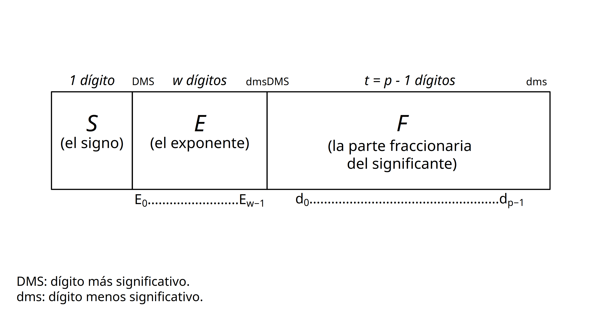
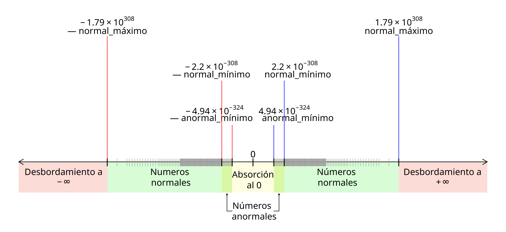

---
format:
  pdf:
    include-in-header:
      - text: |
            \rhead{Documentación de \textbf{R} \textbf{\emph{\ver}}}
            \lhead{\code{double} \code{\{base\}} \pseudocode{vector doble}}
  html:
    title: "Funciones para crear o verificar vectores de tipo *doble*"
    subtitle: "Documentación de R 4.3.0"
---

\title{\LARGE{Funciones para crear o verificar vectores de tipo \textit{doble}}
\\
\medskip\large{\normalfont{Documentación de R \ver}}
\\
}
\maketitle

## Descripción {#descripcion .title}

La función **`double()`** creará un vector de tipo *doble* (`"double"`) que podrá almacenar valores de un subconjunto amplio de los números reales ($\pm1.79×10^{308}$) con una exactitud máxima de hasta quince dígitos. Para conocer más sobre la precisión y exactitud de los números reales en **R**, puedes consultar más adelante la sección [Definición de los vectores *dobles*](#sec-definicion-dobles).

La función **`as.double()`** intentará convertir en un vector de tipo *doble* a cualquier clase de objeto. Por su parte, la función **`is.double()`** verificará si un objeto es de tipo *doble*.

La función **`single()`** creará un vector de tipo *doble* para almacenamiento de números reales, pero añadirá un atributo (`"Csingle"`) que permitirá identificar al vector con el tipo de datos *sencillo* a nivel interno del código de **R**.

El tipo de datos *sencillo* podrá almacenar un subconjunto menos amplio de los números reales ($±3.4×10^{38}$). Para conocer más sobre este tema, puedes consultar más adelante la sección [Los parámetros del formato de punto flotante en la norma *IEEE-754*](#sec-parámetros-ieee-754).

La función **`as.single()`** intentará convertir cualquier objeto en un vector de tipo *doble*, además, añadirá un atributo (`"Csingle"`) que permitirá identificar al vector como uno de tipo *sencillo* a nivel interno del código de **R**.

La función [**`numeric()`**](numeric.fun) es idéntica a la función **`double()`** y la función [**`as.numeric()`**](numeric.fun) es idéntica a **`as.double()`**. La función [**`is.numeric()`**](numeric.fun) comprobará si un vector es de [tipo](typeof.fun "typeof {base}") *doble* (`"double")` o de tipo [*entero*](integer.fun) (`"integer")`.

Estas funciones existen como una denominación más práctica para trabajar con números reales en **R**. Para conocer más sobre este tema, puedes consultar más adelante la sección [Funciones para crear vectores *dobles*](#sec-funciones-crear-dobles).

La función [**`c()`**](c.base "c {base}") creará un vector *doble* si se utiliza para combinar valores reales que estén separados por comas.

\hypersetup{linkcolor=black} \renewcommand{\contentsname}{Contenido} \setcounter{tocdepth}{2} \tableofcontents{}

\hypersetup{linkcolor=blue}

## Sintaxis o forma de uso {#sintaxis .title}

``` {.r eval="FALSE"}
double(length = 0)
as.double(x, ...)
is.double(x)

single(length = 0)
as.single(x, ...)

numeric(length = 0)
as.numeric(x, ...)
is.numeric(x)

c(...)
```

## Argumentos {#argumentos .title}

\small

+----------------------+--------------------------------------+---------------------------------------------------------------------------------------------------------------------------------------------------------------------------------------------------------------------------------------------------------------------------------------------------+
| Nombre del argumento | Valor esperado                       | Propósito                                                                                                                                                                                                                                                                                         |
+:=====================+:=====================================+:==================================================================================================================================================================================================================================================================================================+
| `length=`            | Un valor entero mayor o igual a cero | Determina la longitud deseada del vector, es decir, el número de elementos que almacenará. El argumento de longitud aceptará números enteros no negativos. Los valores reales (es decir, continuos) serán convertidos a enteros y la aportación de más de un valor devolverá un mensaje de error. |
|                      |                                      |                                                                                                                                                                                                                                                                                                   |
| ~*longitud*~         |                                      |                                                                                                                                                                                                                                                                                                   |
+----------------------+--------------------------------------+---------------------------------------------------------------------------------------------------------------------------------------------------------------------------------------------------------------------------------------------------------------------------------------------------+
| `x=`                 | Un objeto                            | Un objeto para ser coaccionado o verificado como vector de tipo *doble*.                                                                                                                                                                                                                          |
+----------------------+--------------------------------------+---------------------------------------------------------------------------------------------------------------------------------------------------------------------------------------------------------------------------------------------------------------------------------------------------+
| `...`                | Otros argumentos                     | Otros argumentos que serán pasados desde o hacia otras funciones.                                                                                                                                                                                                                                 |
+----------------------+--------------------------------------+---------------------------------------------------------------------------------------------------------------------------------------------------------------------------------------------------------------------------------------------------------------------------------------------------+

: Argumentos para las funciones de creación y verificación de vectores *dobles.* {#tbl-args}

\normalsize

## Detalles {#detalles .subtitle}

### Definición de los vectores *dobles* {#sec-definicion-dobles .subtitle}

Los vectores de tipo *doble* son estructuras fundamentales o *atómicas* de **R** destinadas al almacenamiento exclusivo de números reales en celdas contiguas y diseñadas para la realización de operaciones individuales o en paralelo con los elementos de estas celdas [@r_development_core_team_r_2024, 3].

Los vectores *dobles* son el único tipo de objeto en **R** que permite guardar, mostrar y realizar operaciones matemáticas con un subconjunto amplio de los números reales del sistema de numeración decimal, en el intervalo que va de $-1.79 \times 10^{308}$ a $+1.79 \times 10^{308}$, aproximadamente.

Un vector es una estructura que permite almacenar algún *tipo de datos* en celdas indizadas o numeradas y cuyos elementos individuales, a veces llamados *escalares*, son accesibles mediante [operaciones de indización](extract.base) con números enteros [@abelson_structure_1996, 534]. Por su parte, un *tipo de datos* es una categorización de un conjunto de valores que comparten propiedades similares, y de un conjunto de operaciones —computacionales y matemáticas— definidas para esos valores [@wirth_algorithms_1976, 4].

En **R**, los vectores son la base para construir estructuras más complejas como [matrices](matrix.base), [arreglos](array.base), [listas](list.base) o [marcos de datos](data.frame), las cuales pueden almacenar seis tipos de datos fundamentales o *atómicos*: [*lógico*](logical.base) (`"logical"`), [*entero*](integer.base) (`"integer"`), [complejo](complex.base) (`"complex"`), [*carácter*](character.base) (`"character"`), [*crudo*](crudo.base) (`"raw"`) y *doble* (`"double"`).

En particular, el tipo de datos *doble* consiste en un formato de almacenamiento y representación de números reales basado en la *aritmética binaria de punto flotante.*

La aritmética binaria de punto flotante es el sistema interno más extendido entre las computadoras actuales para aproximarse a la aritmética decimal de los números reales. Básicamente, es un formato numérico similar a la notación científica que permite realizar operaciones matemáticas con los valores almacenados.

La denominación «doble» para este tipo de datos es resultado de comparar el tamaño original de agrupación de memoria destinado al almacenamiento de números reales, de $32$ bits, con respecto al tamaño del formato más reciente, de $64$ bits.

Debido a las características del formato binario de punto flotante, el tipo de datos *doble* almacenará y representará a los números reales con una *precisión* y *exactitud* limitadas.

En general, la *precisión* de una cantidad se refiere al número de cifras significativas u órdenes de magnitud (centenas, decenas, unidades, décimas, centésimas, etc.) que es posible almacenar o representar en pantalla. En cambio, la *exactitud* se refiere al grado mínimo de error de redondeo en el resultado de las operaciones aritméticas de la computadora [@muller_handbook_2018, 100].

Con respecto a la precisión, **R** desplegará de manera prederminada a los números reales con un máximo de siete dígitos, aunque todo valor continuo podrá almacenarse con hasta veintidós cifras significativas.

Al igual que otros lenguajes de programación, **R** podrá desplegar un máximo de veintidós cifras significativas para las operaciones matemáticas con valores de tipo *doble*. Para mostrar más cifras que las representadas originalmente, puedes modificar el número de dígitos desplegados con el argumento `digits=` de la función [**`options()`**](options.base).

En cuanto a la exactitud, el tipo de datos *doble* sólo podrá almacenar un máximo de quince dígitos sin error de redondeo, es decir, de forma exacta. A partir del dígito dieciséis, las cifras almacenadas tendrán un error de redondeo cada vez mayor conforme aumente el grado de precisión desplegado.

Una precisión mayor a veintidós dígitos no suele tener ningún significado práctico, no obstante, esta precisión existe a nivel interno para garantizar la exactitud de las operaciones matemáticas visibles. Si deseas conocer cómo está almacenado un número en la memoria más allá de los veintidós dígitos desplegables, puedes consultar las opciones de la función [**`formatC()`**](formatC.base).

Aunque es muy conveniente no perder de vista las limitaciones en precisión y exactitud de los valores *dobles*, la gran mayoría de aplicaciones estadísticas y científicas no suele demandar una precisión mucho mayor a la ofrecida por el formato *doble* de punto flotante [@muller_handbook_2018, 4].

Para conocer más información sobre cómo ampliar la exactitud de las operaciones matemáticas por encima de los límites de los valores *dobles*, puedes consultar más adelante la sección [La representación de valores matemáticos y estadísticos especiales](#sec-valores-especiales). Igualmente, si deseas profundizar sobre las características de la aritmética de punto flotante, puedes consultar más adelante la sección [El formato de almacenamiento de los vectores *dobles*](#sec-detalles-almacenamiento).

### Funciones para crear vectores *dobles* {#sec-funciones-crear-dobles .subtitle}

Las funciones básicas para crear vectores *dobles* son **`double()`**, [`numeric()`](numeric.base) y [**`c()`**](c.base "c {base}")*.* Los vectores *dobles* podrán almacenar números reales en cada elemento con una precisión de hasta quince cifras significativas exactas en el intervalo aproximado de $\pm1.79×10^{308}$. A continuación se describen sus características más importantes*.*

**`double()`** creará un [vector](vector) *doble* con el número de elementos especificado en el argumento de longitud, `length=`. Al momento de su creación, cada elemento del vector será igual a cero (`0`). Enseguida, se podrán [asignar](assign.base "assignOps {base}") valores reales positivos o negativos, así como [valores no disponibles](na.base) (`NA` o `NA_real_`), a los elementos del vector creado.

La función [**`numeric()`**](#0) es idéntica, en propósito e internamente, a la función **`double()`**. Existe como una denominación más práctica para referirse a la función de creación de vectores que trabajarán con números reales.

[**`c()`**](base.c "c {base}") creará un vector *doble* si es utilizada para combinar valores reales que estén separados por comas. Por ejemplo, como en: `c(1.414214, 2.718282, 3.141593)`. La combinación de elementos con valores reales creará un vector de tipo *doble*. Si deseas obtener más información sobre cómo combinar elementos para crear vectores de un tipo determinado, puedes consultar la página de ayuda de la función [**`c()`**](base.combine).

En particular, la función [**`c()`**](c.abse) es de tipo [primitivo](Primitive.base "Primitive {base}"), por lo que su código fuente está implementado de manera interna y no será visible directamente por la usuaria.

**`single()`** es una función alternativa para crear vectores dobles. Esta función creará un vector de tipo *doble* para almacenamiento y representación de números reales, pero añadirá el atributo `"Csingle"` al vector creado, lo que permitirá identificar a este objeto como uno de tipo *sencillo* a nivel interno del código de **R**.

Los vectores *sencillos* pueden almacenar números reales con una precisión de hasta siete cifras significativas exactas en el intervalo aproximado de $\pm3.4×10^{38}$, es decir, con una precisión y exactitud menor a la de los vectores *dobles*. Ya que todos los números reales son almacenados con el tipo de datos *doble* (`"double"`), **R** no cuenta en realidad con el tipo de datos *sencillo*, también conocido como *flotante* (*`"float"`*) en otros lenguajes de programación.

Para más información sobre la utilización de las funciones para crear vectores *dobles*, puedes ver más adelante la sección [Valor devuelto](#sec-valor).

### Funciones para convertir objetos en vectores *dobles* {#sec-funciones-convertir-dobles .subtitle}

**`as.double()`** intentará convertir al objeto referido en el argumento `x=` en un vector de tipo *doble* y, de tener éxito, devolverá al objeto como un vector de este tipo (`"double"`). Si la coacción no ha sido exitosa, el resultado será un mensaje de error o un valor no disponible (`NA`) por cada elemento no coaccionado.

La función [**`as.numeric()`**](as.numeric) es idéntica, en propósito e internamente, a la función **`as.double()`**. Existe como una denominación más general y práctica para referirse a la función de conversión a objetos que trabajen con números reales.

Las funciones **`as.double()`** y [**`as.numeric()`**](as.numeric) son de tipo primitivo, por lo que su código fuente está implementado de manera interna y no será visible directamente para la usuaria.

La función **`as.single()`** intentará convertir cualquier objeto en un vector de tipo *doble.* Esta función añadirá el atributo `"Csingle"` al objeto, lo que permitirá identificar al vector como uno de tipo *sencillo* a nivel interno del código de **R**.

En realidad, el atributo `"Csingle"` se utilizará solamente en la interfaz interna de **R** con los lenguajes de programación [C](C) y [Fortran](Fortran) para indicar que los objetos creados con las funciones **`single()`** y **`as.single()`** deberán ser interpretados como vectores de *precisión sencilla*, aunque a nivel externo funcionarán como vectores *dobles*.

### Funciones para verificar si los objetos son vectores *dobles* {#funciones-verificar-dobles .subtitle}

Por su parte, la función **`is.double()`** se utilizará para verificar si un [vector](vector) o [matriz](matrix.base) es de [tipo](typeof.base "typeof {base}") *doble* (`"double")`. En particular, **`is.double()`** es una función [primitiva](Primitive.base "Primitive {base}"), por lo que su código fuente está implementado de manera interna y no será visible directamente por la usuaria.

La función [**`is.numeric()`**](numeric.base) comprobará si un vector es de [tipo](typeof.base "typeof {base}") *doble* (`"double")` o de tipo [entero](integer.base) (`"integer")`. Por lo tanto, no es exclusiva para los vectores *dobles* sino para los objetos de [modo](mode.base) [numérico](numeric.base).

Para acceder a más información sobre la utilización de estas funciones, puedes consultar más adelante la sección [Valor devuelto](#sec-valor).

### El formato de almacenamiento de los vectores dobles {#sec-detalles-almacenamiento .subtitle}

En **R**, los valores de los vectores dobles son almacenados en el formato binario de punto flotante. Este formato interno hace posible la representación en pantalla de un conjunto de números continuos —los reales— con los elementos de un conjunto de números discretos —los dígitos de la máquina o *bits*— [@muller_handbook_2018, 3].

El almacenamiento binario de valores continuos a partir de un número de *bits* discreto implica que sólo algunos números reales podrán ser almacenados de forma exacta y que, por lo tanto, habrá usualmente una pequeña diferencia entre el valor almacenado y el valor representado en pantalla [@goldberg_what_1991, 5]. La diferencia entre el valor almacenado de algunas cantidades y su valor representado es uno de los rasgos fundamentales, en general, de la aritmética de punto flotante [@goldberg_what_1991, 6].

Por lo general, el tipo de datos *doble* de **R** está implementado de acuerdo a la norma *IEEE-754* del Instituto de Ingenieros Eléctricos y Electrónicos de Estados Unidos (IEEE por sus siglas en inglés), equivalente a la norma internacional *ISO/IEC-60559:2020* de la Comisión Internacional de Electrotecnia de la Organización Internacional para la Estandarización (ISO, por sus siglas en inglés) [@isoiec_605592020_2020].

De acuerdo con esta norma, los valores de precisión doble usarán $64$ dígitos binarios (ocho *bytes*) para almacenar internamente un número real, mientras que los valores de precisión sencilla utilizarán $32$ dígitos binarios (cuatro *bytes*).

Los *bits* de almacenamiento doble se distribuirán de la siguiente manera: un dígito corresponderá al signo del significante, $52$ dígitos almacenarán al significante, y once dígitos corresponderán al exponente de la base. Puedes consultar más adelante la sección [El formato de punto flotante de acuerdo a la norma *IEEE-754*](#sec-estandar-ieee-754) para conocer más detalles sobre estos conceptos.

En específico, los bits de almacenamiento binario permtirán almacenar números reales con una exactitud de hasta quince dígitos en formato decimal y hasta veintidós dígitos de manera aproximada.

Esto significa que, después del dígito quince la precisión de una cifra almacenada aumentará sólo con una reducción o costo en su exactitud. Para más información, puedes consultar a continuación la sección [La representación de los valores *dobles*](#sec-detalles-representacion).

En la actualidad, la norma *IEEE-754* utiliza la denominación *binaria64* (*binary64*) para referirse a la *precisión doble* y la denominación *binaria32* (*binary32*) para referirse la *precisión sencilla*.

No obstante, a nivel de los lenguajes de programación, la *precisión doble* es todavía conocida ampliamente como el tipo de datos *`"double"`* o *`"numeric"`*, mientras que la precisión *sencilla* se suele denominar como el tipo de datos *`"single"`* o *`"float"`*. Si deseas conocer más información sobre este tema puedes consultar más adelante la sección [Los parámetros del formato de punto flotante en la norma *IEEE-754*](#sec-parámetros-ieee-754).

La norma *IEEE-754* también contempla el almacenamiento y representación de valores especiales para casos numéricos límite, como los infinitos ($\pm\infty$) y las operaciones matemáticas no definidas ($\nexists$). Los infinitos son representados con la abreviatura `-Inf` para el infinito negativo y la abreviatura `+Inf` para el infinito positivo, mientras que las operaciones no definidas son representadas con el acrónimo `NaN`. Además, se definen como válidos los valores negativo (`-0`) y positivo (`+0`) de cero, los cuales son equivalentes a cero (`0`).

En las computadoras personales modernas, la aritmética de punto flotante suele implementarse desde la maquinaria del equipo en unidades de extensión especiales (SSE, AVX y FPU, por sus siglas en inglés) del procersador central.[^1] Por lo tanto, en última instancia, el manejo de los números de *precisión doble* dependerá de las características del procesador, las unidades de extensión y el compilador de la computadora donde se instale **R**. Si la maquinaria del equipo o las aplicaciones de sistema se adhieren a la norma *IEEE-754*, entonces **R** también lo hará.

[^1]: SSE se refiere a

Para conocer más detalles sobre los límites y el tipo del almacenamiento numérico en tu plataforma de sistema puedes ver la página de ayuda sobre las [características numéricas del equipo](.Machine).

### La representación de los valores *dobles* {#sec-detalles-representacion .subtitle}

Las cifras en formato *doble* aparecerán en pantalla en notación fija del sistema de numeración decimal, es decir, como números continuos. Por ejemplo, las constantes matemáticas $\sqrt{2}$, $e$ y $\pi$ podrán invocarse con las expresiones `sqrt(2)`, `exp(1)`, o `pi` y aparecerán en la consola como: `1.414214`, `2.718282` y `3.141593`, respectivamente.

De manera predeterminada, **R** desplegará hasta siete dígitos para cualquier valor numérico. Si la cifra incluye fracciones decimales, entonces el punto decimal no será contado como uno de los dígitos. Cuando la usuaria desee desplegar más dígitos en la pantalla, deberá especificarlo con el argumento `digits=` de la función [**`options()`**](options.base).

Debido a los límites en el tamaño de la agrupación de memoria para el tipo *doble*, el número máximo de dígitos desplegables será de veintidós, de los cuales sólo los primeros quince podrán representar siempre valores exactos. En consecuencia, a partir del dígito dieciséis algunos valores sólo podrán representarse de forma aproximada.

::: {#comparacion-igualdad .callout-caution style="font-size:1.0em"}
A causa de estas características, la [comparación lógica](logical.base) de igualdad ( `==` ) para dos números reales que en pantalla aparezcan de manera idéntica podría devolver un [valor lógico](logical.base) falso (`FALSE`), ya que el resto de decimales ocultos podría ser diferente. A menudo, este nivel de precisión no es relevante. En consecuencia, para realizar comprobaciones lógicas sobre la igualdad de valores reales puedes utilizar preferentemente la función [**`all.equal()`**](#0), la cual comprobará la igualdad de los valores hasta un nivel de exactitud más práctico.
:::

En América Latina y Estados Unidos el símbolo de separación de enteros y fracciones suele ser el punto decimal ( `.` ), mientras que en España y algunos países de Europa se utiliza la coma ( `,` ).

Adviértase, sin embargo, que **R** utilizará siempre el punto decimal para desplegar valores reales, independientemente de la [configuración regional](l10n_info.base) de la plataforma de sistema en la que se encuentre instalado.

#### La notación científica exponencial {#sec-notacion-cientifica-e .subtitle}

De manera relevante, los límites de la representación de los números reales en **R** ( $\pm1.79 \times 10^{308}$) comprenden órdenes de magnitud más precisos que el despliegue de valores con quince cifras significativas exactas y veintidós aproximadas.

Por ello, cuando un número tenga una precisión mayor a veintidós dígitos, pero se encuentre dentro de los límites numéricos del almacenamiento *doble*, **R** desplegará en pantalla una forma abreviada de la notación científica. A este formato de despligue se le denomina *notación científica exponencial*.

La notación científica exponencial es una forma de representar números muy grandes o muy pequeños de forma compacta. Los números serán mostrados en el formato `Me±N,` donde `M` representa un número decimal que será multiplicado por el valor de la letra `e`,la cual a su vez representa al número $10$ elevado a la potencia de un entero `N`.

La notación científica exponencial es útil porque las potencias con superíndices (de la forma $x^n$) no se pueden mostrar en la consola ni en el código fuente de **R**. Por ejemplo, el número $100\,000$ se puede desplegar en la consola como `100000` en notación decimal fija o como `1.0e5` en notación científica exponencial, pero no como su equivalente en notación científica convencional: $1.0 \times 10^5$.

Así, la notación científica exponencial posibilita la representación de números con más de quince cifras significativas de forma compacta, siempre que se encuentren dentro de los límites del almacenamiento *doble*.

#### La representación de valores matemáticos y estadísticos especiales {#sec-valores-especiales .subtitle}

Cuando los valores sean demasiado grandes o demasiado pequeños para ser representados adecuadamente, incluso con la *notación científica E*, los valores se desbordarán a alguno de los infinitos (`±Inf`) o serán absorbidos al cero (`0`) por la derecha (`+0`) o por la izquierda (`-0`).

En el primer caso, los vectores *dobles* representarán al infinito positivo ($+\infty$) con los literales `+Inf` o `Inf` y al infinito negativo ($-\infty$) con los caracteres `-Inf`. En el segundo caso, el valor positivo o negativo asociado al cero ($0$) será resultado de operaciones cuyo limite matemático sea cero. Cabe destacar que los valores `-0` y `+0` son completamente equivalentes a `0`.

Si deseas trabajar con números que tengan más de quince cifras significativas exactas en notación decimal fija (es decir, sin hacer uso de la notación científica E) o, incluso, realizar cálculos con tipos exactos, es recomendable el uso de paquetes especializados. Por ejemplo, el paquete **{[`Rmpfr`](https://CRAN.R-project.org/package=Rmpfr)}** permite realizar operaciones aritméticas con números de precisión decimal arbitraria y sin error de redondeo.

Con todo, pocos campos de la ciencia necesitan precisiones mayores a este umbral, por lo que un gran número de aplicaciones estadísticas podrán realizarse adecuadamente con la *precisión doble* [@muller_handbook_2018, 3].

El concepto estadístico de *valor perdido* tiene su expresión correspondiente en **R** por medio de los *valores no disponibles*.[^2] Para cada tipo de vector atómico, salvo para los [vectores crudos](raw.base) (`"raw"`), existe un tipo propio de valor no disponible, representado en pantalla por los caracteres `NA` (del inglés *Not Available*). Así, al tipo *doble* le corresponderá, a nivel interno, el valor no disponible `NA_real_`.

[^2]: En estadística, los valores perdidos son valores no observados o irrecuperables que serían significativos para el análisis de haber sido incorporados [@little_problem_2020, 4].

Si deseas asegurarte de que los vectores *dobles* reciban solamente valores no disponibles de tipo *doble*, puedes utilizar directamente el literal `NA_real_` (en vez de la forma más simple `NA`) en las operaciones de asignación de la consola o del código fuente. Para mayor información puedes consultar más adelante la sección *Ejemplos*, así como la página de ayuda de los [valores no disponibles](NA.base).

Por otro lado, si se realizan operaciones matemáticas no definidas —como la división de cero entre cero o la resta de infinitos— **R** desplegará un valor *doble* especial. Este valor será desplegado en la pantalla como `NaN`, cuyos caracteres significan *Valor no Numérico* (del inglés *Not a Number*) pero que puede interpretarse mejor como el concepto matemático de resultado no definido o conjunto inexistente: $\nexists$.

Al igual que en el lenguaje [C](c.language), en **R** la carga de bits de un valor no númerico `NaN` no aportará ninguna información de diagnóstico sobre la operación que generó este valor. Por lo tanto, esto tendrá que deducirse a partir de la depuración del código fuente. Si deseas acceder a más información sobre los *Valores no Numéricos*, puedes consultar la página de ayuda sobre los [valores NaN](is.finite).

### Características de los vectores dobles como objetos {#sec-detalles-objetos .subtitle}

Los vectores *dobles* (`"double"`), al igual que el resto de vectores atómicos, sólo podrán contener elementos del mismo tipo, en este caso, números reales. No obstante, esto también incluye el almacenamiento de valores enteros en forma exacta, incluso más allá del rango de almacenamiento del [tipo entero](integer.base) (`"integer"`).

**R** cuenta con dos denominaciones para referirse a los vectores que almacenan números reales: `"double"` y `"numeric"`, lo que responde a una inercia histórica.[^3] Para evitar confusiones, es conveniente distinguir entre el [*tipo*](typeof.base) y el [*modo*](mode.base) de almacenamiento, así como entre las [*clases*](class.base) de objetos que existen en **R**.

[^3]: En las primeras versiones de **R** también se usó el tipo `"real"` para referirse a estos vectores, pero [desapareció](defunct.base) a partir de la versión 3.0.0.

El [tipo de almacenamiento](typeof.base) define al formato de los datos que puede contener un vector atómico. Especialmente, **R** cuenta con tres tipos de almacenamiento numérico: el [tipo *entero*](integer.base), el tipo *doble* y el [tipo *complejo*](complex.base).

Por su parte, el [modo de almacenamiento](storage.mode) también define al tipo de datos que contendrá un vector, pero agrupa a algunos tipos de almacenamiento con características similares.

Mientras que el tipo de almacenamiento es una clasificación excluyente, el modo de almacenamiento es una clasificación genérica. Ello permite agrupar a algunos tipos de almacenamiento con características similares en una sola categoría.

Por ejemplo, los vectores *dobles* y los *enteros* comparten en común el modo de almacenamiento [*numérico*](numeric.base) (`"numeric"`), de forma que será posible identificarlos como objetos similares para algunas tareas en común.

Además de poseer un tipo y un modo de almacenamiento, los vectores son esencialmente entidades abstractas que poseen atributos, es decir, son objetos del lenguaje. Uno de los atributos más importantes de cualquier objeto es su [clase](class.base), la cual determina los métodos y funciones que se le podrán aplicar.

En este sentido, todos los tipos numéricos de **R** poseen una clase propia que define las operaciones matemáticas y estadísticas que les corresponden. Así, el [tipo *entero*](integer.base) (`"integer"`) pertenece a la [clase *entero*](integer-class.base) (`"integer"`), el tipo *doble* (`"double"`) pertenece a la [clase *numérico*](BasicClasses-methods.base) (`"numeric"`), y el [tipo *complejo*](complex.base) (`"complex"`) pertenece a la [clase complejo](BasicClasses-methods.base) (`"complex"`).

Los objetos de la clase *entero* admiten las operaciones aritméticas y estadísticas básicas. Los objetos de la clase *numérico* admiten todas las operaciones aritméticas y estadísticas aplicables a la clase *entero*, y, además, permiten todas las operaciones aritméticas y estadísticas para los números reales. Finalmente, los objetos de la clase *complejo* admiten las operaciones que se pueden realizar con la clase *entero* y *numérico*, pero también las operaciones aritméticas propias de los números complejos.

Si se realiza una operación en común entre objetos numéricos de diferente clase, **R** coaccionará a los objetos involucrados a la clase que admita más operaciones, y promoverá el tipo de almacenamiento del vector a la clase correspondiente.

Por ejemplo, si se realiza una operación matemática entre un vector *entero* y uno *doble*, el resultado será un vector de tipo *doble*. Y si se realiza una operación entre vectores *enteros*, *dobles* y *complejos*, el resultado será un vector de tipo *complejo*.

### Los tipos de datos para los números reales {#sec-detalles-tipos}

Los tipos de datos se definen, por un lado, por su formato de almacenamiento y, por otro, por el conjunto de operaciones y funciones que son válidas exclusivamente para ellos. En particular, los tipos de datos reales son categorías numéricas de los lenguajes de programación para representar las propiedades matemáticas de los números reales [@wirth_algorithms_1976, 4]. Algunos nombres de estos tipos son, por ejemplo: `"float"`, `"double"` o `"long double"`.

Los números reales, como conceptos matemáticos, poseen propiedades fundamentales que un ordenador debería ser capaz de reflejar. Por ello, si se consideran sus propiedades más importantes será más fácil comprender las características y limitaciones de los tipos de datos utilizados para su representación.

#### Propiedades de los números reales {#sec-propiedades-reales .subtitle}

En términos simples, los números reales son aquellos que pueden representarse con la marca de separación de enteros y fracciones decimales, ya sea que esta marca se trate del punto ($.$) o la coma ($,$) y pueden ser números tanto positivos como negativos incluyendo al cero.

En términos matemáticos, los números reales se refieren al conjunto $\mathbb{R}$ que comprende a los subconjuntos de los números racionales $\mathbb{Q}$, definidos como la razón de dos enteros $\frac{a}{b}$ donde $b≠0$, y a los irracionales, los cuales no pueden ser representados exactamente por la razón de dos números enteros [@djao_24_real_2013].

En particular, los números reales poseen tres propiedades muy importantes: i) su dominio es infinito, por lo que los valores se extienden indefinidamente hacia ambos lados de la recta numérica; ii) su densidad es continua, lo que significa que entre un número real $x$ y otro número real $y$ siempre existirá otro número real $z$, sin importar cuán cercanos se encuentren $x$ y $y$ [@tanenbaum_structured_2013, 683]; y iii) algunos valores reales pueden tener una precisión infinita, por lo que sólo podrán ser representados exactamente por fracciones o símbolos.

Estas propiedades implican que los números reales son incontables. Ya que las computadoras sólo almacenan una cantidad de información finita, los formatos para números reales sólo podrán almacenar un rango y número limitado de éstos de forma aproximada.

#### Los diferentes formatos de almacenamiento de los números reales {#sec-formatos-almacenamiento-reales .subtitle}

Los formatos numéricos son abstracciones que prescriben las reglas de implementación de los sistemas de numeración así como los procedimientos aritméticos en los ordenadores [@isoiec_605592020_2020,16]. A su vez, a nivel de los lenguajes de programación, los tipos de datos son las representaciones externas de los formatos numéricos.

Existen diferentes formatos para trabajar con números reales, algunos anteriores a la generalización de la aritmética de punto flotante y otros posteriores a esta. Entre los primeros se encuentra la aritmética de *punto fijo*, que destina un número predeterminado de dígitos a las partes entera y fraccionaria de una cantidad, y es utilizada en entornos en donde una precisión limitada y regular resulta más útil, como en el procesamiento digital de señales [@yates_fixed-point_2020, 3] o las operaciones comerciales.

Otras alternativas tradicionales para trabajar con números reales son el cálculo simbólico, el cálculo de fracciones, la aritmética de intervalos o el formato decimal codificado en binario, ampliamente extendido en las terminales de pago [@evans_how_2023, 26].

En los últimos años, se han implementado con éxito “nuevos” formatos numéricos (*bfloat*, *FP16*, *FP8*) que reducen las especificaciones del formato de punto flotante con el propósito de mejorar el rendimiento computacional en el ámbito de la inteligencia artificial [@rouhani_microscaling_2023]. Otras propuestas han intentado plantear un formato diferente que pueda sustituir la norma *IEEE-754*, aunque sin mucho éxito. Por ejemplo, el formato *posit*, cuyo objetivo es incrementar la exactitud de los cálculos científicos de manera más eficiente [@new_generation_arithmetic_standard_2020].

Con todo, el formato *binario de punto flotante* avalado por la norma *IEEE-754* es todavía el preferido por los fabricantes de maquinaria computacional [@narasimhan_nvidia_2022], lo que determina en buena medida la especificación de los tipos de datos de los lenguajes de programación. Por ello, a continuación se exponen las características técnicas más importantes de la norma *IEEE-754*.

#### El formato de punto flotante de acuerdo a la norma *IEEE-754* {#sec-estandar-ieee-754 .subtitle}

La norma *IEEE-754* (equivalente a la norma internacional *ISO/IEC-60559*) regula al *formato de punto o coma flotante* en la mayoría de las computadoras del mundo. Un formato de punto flotante es una estructura de datos que especifica los campos que componen un número de punto flotante, la disposición de dichos campos y su interpretación aritmética [@oracle_oracle_2017,19]. En esencia, consiste es un formato numérico similar a la notación científica que permite realizar operaciones matemáticas con los valores almacenados.

La norma *IEEE-754* fue aprobada en 1985 por el Instituto de Ingenieros Eléctricos y Electrónicos (IEEE) de Estados Unidos con el propósito de mejorar la portabilidad de los programas matemáticos entre computadoras con diferente arquitectura, algo muy difícil de lograr hasta antes de su implementación [@hough_ieee_2019, 110].[^4]

[^4]: El diseño de la norma fue propuesto en 1977 por John Palmer de Intel a un grupo de profesores y estudiantes de la Universidad de Berkeley encabezados por William Kahan, Jerome Coonen y Harold Stone [@ieee_milestonesieee_2024]. Desde su publicación (1985), la norma ha experimentado varias revisiones importantes, la primera ocurrió entre 2000 y 2008, y la última entre 2015 y 2019; el cambio más visible de la primera revisión (2008) fue la fusión de la norma *IEEE-854-1987* con la de 1985 para agregar otras bases de numeración al tradicional formato binario. Sin embargo, el cambio más importante consistió mover el enfoque desde una especificación de parámetros que era más cercana a la maquinaria, a una especificación que fuera más próxima a las aplicaciones de sistema al tiempo que se preservó la compatibilidad con la versión de 1985 [@hough_ieee_2019, 111]. Por otra parte, la segunda revisión oficial (2019) actualizó los procedimientos de las operaciones aritméticas con el fin de asegurar su exactitud, pero mantuvo la compatibilidad con la actualización de 2008. Se prevé que la siguiente revisión sea publicada en 2029.

Aunque actualmente la portabilidad no es completa, incluso entre sistemas que se adhieren a la norma *IEEE-754* [@oracle_oracle_2017, 168], se consiguió una mejoría muy importante en este ámbito gracias a que dicho estándar especificó claramente los formatos de intercambio numérico, introdujo el manejo de las excepciones matemáticas, y requirió el redondeo exacto de las operaciones aritméticas [@muller_handbook_2018,47].[^5] Hoy, la utilidad principal de la norma *IEEE-754* consiste en ofrecer procedimientos confiables para la realización de cálculos matemáticos en diversos campos de la ciencia [@muller_handbook_2018, 4].

[^5]: La norma exige que los resultados de la adición, sustracción, multiplicación y división sean redondeados exactamente. Esto significa que el resultado deberá ser calculado exactamente en sus operaciones intermedias y luego redondeado al número de punto flotante más cercano. [@goldberg_what_1991, 18]

En esencia, la norma *IEEE-754* define diversos formatos numéricos basados en estructuras de intercambio de *punto flotante* que representan las propiedades de los números reales, así como los procedimientos computacionales para que las operaciones aritméticas devuelvan los resultados matemáticos esperados [@muller_handbook_2018, 47]. En especial, la norma preestablece valores especiales para casos numéricos límite, tales como los infinitos ($\pm\infty$), los valores muy próximos a cero no normalizados, y las operaciones matemáticas cuyo resultado no está definido ($\nexists$).

Tanto las estructuras como las operaciones de la norma son implementadas en las diferentes capas de los sistemas informáticos —desde la maquinaria del equipo hasta las bibliotecas de los lenguajes de programación— y, en conjunto, constituyen una aritmética o entorno de punto flotante [@oracle_oracle_2017, 1].[^6]

[^6]: Un formato de almacenamiento podrá ser considerado un *formato aritmético* si todas las operaciones obligatorias definidas por la norma están soportadas en el sistema [@muller_handbook_2018, 47].

La aritmética de punto flotante es una aproximación sistemática a la aritmética de los números reales basada en la notación científica tradicional [@ieee_754-2019_2019, 14]. La denominación *punto flotante* proviene de la posibilidad de que el punto (o coma) decimal de una cantidad representada pueda moverse a lo largo de los órdenes de magnitud de una cifra [@wikipedia_floating-point_2025].

Dado el interés de esta página de ayuda en los tipos de datos numéricos, su contenido se centrará en describir la estructura de los campos y los formatos de almacenamiento de la norma *IEEE-754*, y no abundará en la especificación de los procedimientos computacionales que norman las operaciones aritméticas.[^7]

[^7]: Si deseas profundizar en la comprensión de estas operaciones puedes consultar el libro [*Modern Computer Arithmetic*](https://members.loria.fr/PZimmermann/mca/pub226.html) de @brent_modern_2010.

En este sentido, la norma *IEEE-754* contempla dos parámetros que determinan el nombre y las características fundamentales de los formatos de punto flotante. Estos son: i) la base numérica $b$ en la que serán almacenados los números reales, y ii) el tamaño de agrupación de memoria $W$ que indica el número fijo de dígitos destinados al almacenamiento de una cifra real completa. Tan sólo estos dos parámetros definen las características principales de los diferentes *subformatos* de números de punto flotante existentes [@muller_handbook_2018, 63].

A su vez, los números de punto flotante son únicamente los valores finitos e infinitos que se puedan *representar* internamente en un formato con tres campos: un signo ($\pm$), un exponente ($e$) y una parte significativa ($m$) [@ieee_754-2019_2019, 14] expresados en una base de numeración $b$.[^8] La decodificación de estos campos podrá devolver, además de números finitos y los valores infinitos con signo (`+Inf` o `-Inf`), valores no numéricos (`NaN`). Estos últimos no se consideran números de punto flotante pero sí *datos* de punto flotante [@ieee_754-2019_2019,14]. La decodificación consiste en aplicar los parámetros de un subformato específico de punto flotante a la multiplicación del signo y el significante con la base de numeración --también llamado radicando-- elevada al valor del exponente, como se muestra en la ecuación siguiente.

[^8]: El término *representación*, tal como es usado en la norma *IEEE-754*, se refiere a un elemento sin codificar de un formato. El valor numérico de una representación se obtiene a través de la codificación, la cual asocia a un conjunto de valores de punto flotante a una cadena de bits concreta. Por consiguiente, es conveniente diferenciar entre la representación interna de un formato de punto flotante y la representación en pantalla de valores para la usuaria.

$$
x = \pm m \cdot b^e = b^e \cdot m 
$$ {#eq-punto-flotante-1}

Los parámetros de codificación de cada subformato permiten asociar una cadena de bits concreta a los valores de un dato de punto flotante. Esto se consigue al sustituir los valores específicos de cada subformato en la @eq-punto-flotante-1. En la sección [siguiente](#sec-parámetros-ieee-754), se amplían los detalles de los parámetros de codificación para los formatos canónicos de la norma *IEEE-754*.

::: callout-important
La reducción de un número infinito de valores reales a un número finito de campos implicará algunas limitaciones aritméticas importantes. En primer término, al representar solamente a un subconjunto de los números reales, ciertas propiedades de la aritmética real no se cumplirán siempre en la aritmética de punto flotante --como, por ejemplo, la asociatividad de la adición [@ieee_754-2019_2019, 17]. Además, ya que el número de campos para almacenar un número es finito, la representación numérica estará basada en el redondeo [@goldberg_what_1991, 6].\
\
El redondeo podrá introducir un error entre el valor real y resultado de algunas operaciones aritméticas. Este error será por lo general mínimo aunque en casos límite podría ser de mayor consideración [@goldberg_what_1991, 10-12]. Por último, la representación decimal de valores almacenados en la base de numeración binaria implicará que ciertos valores podrán tener una precisión finita sólo en alguna base de numeración, por lo que su representación y valor almacenado diferirán aún cuando la precisión para representarlos o almacenarlos sea suficiente.
:::

Tanto el posible incumplimiento de algunas propiedades aritméticas, la presencia de errores de redondeo, así como las discrepancias de precisiones entre bases de numeración, constituyen características inherentes a la aritmética de punto flotante [@goldberg_what_1991, 7]. No obstante, lejos de evitar su utilización, considerar los parámetros numéricos preestablecidos para los distintos subformatos de la norma *IEEE-754* tiene el propósito de aportar las herramientas para evitar o resolver las excepciones de los casos límite.[^9] Por ello, en la siguiente sección de describirán los principales parámetros de los formatos numéricos de la norma *IEEE-754*.

[^9]: Las limitaciones de la arimética de punto flotante han sido señaladas desde su implementación original. Algunas han tenido una importancia anecdótica mientras que otras han llegado a tener costos económicos [@wikipedia_pentium_2025]. Para una exposición introductoria sobre algunos de los casos límite conocidos de la aritmética de punto flotante puede consultarse las [discusiones de](https://jvns.ca/blog/2023/01/13/examples-of-floating-point-problems/) @evans_examples_2023 y en [*Stack Overflow*](https://stackoverflow.com/questions/588004/is-floating-point-math-broken) a partir de la pregunta de @johnston_is_2009 sobre los problemas de la aritmética de punto flotante. Para un tratamiento más sistemático puede consultarse el trabajo de @monniaux_pitfalls_2008.

##### Los parámetros del formato de punto flotante en la norma *IEEE-754* {#sec-parámetros-ieee-754 .subtitle}

Aunque los números de punto flotante se expresan, de manera general, de la forma definida en la @eq-punto-flotante-1, esta no es la forma en que son almacenados internamente. Precisamente, la norma *IEEE-754* determina los parámetros para codificar el almacenamiento, a nivel interno, de una representción externa de punto flotante.

Por ello, además de permitir la decodificación de una cadena de bits en valores numéricos, los parámetros de los diversos subformatos de la norma *IEEE-754* permiten tener una noción clara de los límites numéricos de cada tipo de datos. Es por eso que a continuación se exponen con detalle sus características más importantes.

En primer término, la norma *IEEE-754* acepta el uso de dos bases numéricas ($b$) para almacenar números reales: la binaria y la decimal ($b \in \{2,10\}$). Aunque los cálculos en el sistema decimal ($b = 10$) son más familiares para las personas, a nivel interno los tipos de datos suelen estar basados en el sistema de numeración binario ($b = 2$).

Independientemente de la base interna, la representación externa de los tipos de datos se hará, por lo general, en el sistema decimal. Para más información, véase la sección [La representación de los valores *dobles*](#sec-detalles-representacion). Dado el uso generalizado a nivel interno del formato binario, esta sección sólo se enfocará en describir las características de los formatos binarios de punto flotante, aunque el funcionamiento de las bases decimales puede también inferirse a partir de de la comprensión de las bases binarias.

El segundo parámetro fundamental es el tamaño de agrupación de memoria $W$. La norma *IEEE-754* define el uso de los valores *canónicos* o convencionales de $16$, $32$, $64$ o $128$ dígitos binarios —o sea, de $2$, $4$, $8$ o $16$ *bytes*— para el almacenamiento de una cifra real completa.

El número de dígitos de $W$ da nombre a los distintos subformatos de punto flotante. En la actualidad, la norma *IEEE-754* utiliza las denominaciones *binaria16* (tipo de datos *`"half"`*) para referirse a la *precisión media*, *binaria32* (tipo de datos *`"single"`* o *`"float"`*) para referirse a la *precisión sencilla*, *binaria64* (tipo de datos *`"double"`* o *`"numeric"`*) para referirse la *precisión doble* y *binaria128* (tipo de datos *`"long double"`*) para referirse a la *precisión cuátruple*.

El número total de valores de punto flotante que un subformato podrá representar es resultado de las permutaciones existentes entre el número de valores que cada dígito puede adoptar de acuerdo a la base ($b = 2$) y el número de dígitos totales del formato ($W \in \{16, 32, 64, 128\}$). 

De este modo, la *precisión media* representará $2^{16}$ valores de punto flotante, la *precisión sencilla* contendrá $2^{32}$ valores; a su vez, la *precisión doble* albergará $2^{64}$ valores y, finalmente, la *precisión cuátruple* contendrá $2^{128}$ valores posibles. En consecuencia, a diferencia de los números reales, el dominio de los números de punto flotante será finito.

Una vez que una base $b$ y una extensión canónica de $W$ han sido definidas, sus dígitos se distribuirán en tres parámetros con asignaciones prederminadas:

a.  Un campo $S$ usado para almacenar un dígito que representará al signo ($s$) del número de punto flotante.
b.  Un campo $E$ distribuído en $5$, $8$, $11$ o $15$ dígitos binarios y usado para almacenar números positivos que representarán al exponente ($e$) del número de punto flotante.
c.  Un campo $T$ distribuido en $10$, $23$, $52$ o $112$ dígitos binarios y usado para almacenar la parte fraccionaria del significante ($m$).

{width="14cm" height="7.5cm"}

El significante se compone de un dígito binario antes de la marca de separación de fracciones —*i.e.* el punto o la coma— y $p-1$ dígitos binarios después de ésta y deberá expresarse en forma *normalizada*;[^10] por consiguiente, el primer dígito siempre será igual a $1$ y $m$ sólo necesitará ser almacenado con con $p-1$ dígitos.

[^10]: En notación científica tradicional un número se encuentra normalizado si el significante es mayor o igual a uno y menor a la base numérica ($1≤m<b$). Por ejemplo, un número en base decimal como $3.14 \times 10^{2}$ se encuentra en forma normalizada, mientras que en la forma $0.314 \times 10^{3}$ no lo estaría ya que el significante tiene un valor menor a uno [@cook_anatomy_2009]. De acuerdo a la norma *IEEE-754*, los números de punto flotante en base binaria se deben almacenar en su forma normalizada, lo que significa que el primer dígito del significante $m$ siempre será igual a $1$.

De esta manera, un número de punto flotante $x$ en la base $b$ es uno para el cual existe al menos una representación exacta en función de la distribución de $W$-dígitos entre los parámetros $s$, $m$ y $e$ de la forma:\
$$
x = (-1)^{s} \cdot b^{e_1e_2...e_{W_e}} \cdot m_0.m_1m_2...m_{p-1} 
$$ {#eq-punto-flotante-2}

La @eq-punto-flotante-2 tiene varias implicaciones, para abordar cada una de ellas con mayor detenimiento, a continuación se analizarán cada uno de sus componentes.

###### El signo

El dígito $s$ tendrá la función de ser el banderín de signo. Ya que las computadoras sólo almacenan valores binarios, el signo de una cadena de bits podrá determinarse con un dígito que cambie de valor dependiendo de la codificación asignada. En el caso de los números de punto flotante, los valores positivos comenzarán con el dígito $0$ y los valores negativos con el dígito $1$. En consecuencia, al igual que los números reales, el dominio de los números de punto flotante se extenderá a ambos lados de la recta numérica aunque no de manera indefinida.

Además, el campo $s$ implica que el número cero ($0$) podrá adoptar un valor positivo (`+0`) o negativo (`-0`) que dependerá del valor del banderín. Sin embargo, ambos valores serán, en términos aritméticos, totalmente equivalentes al valor del cero sin signo (`0`).

###### El exponente

El rango numérico del exponente $e$ es uno de los campos más importantes de la codificación de punto flotante, pues a partir de sus cotas o valores *lìmite* se definen los tipos de números reales y los casos especiales que será posible representar en un tipo de datos.

Así, el tamaño de agrupación de memoria del exponente $W_e$ define el número total de valores de $e$ que es posible representar en un subformato, el cual es resultado de las permutaciones existentes entre el número de valores que cada dígito puede adoptar de acuerdo a la base ($b = 2$) y el número de dígitos totales.

En este sentido, los tamaños de agrupación $W_{e}$ para los formatos canónicos de la norma *IEEE-754* son $5$, $8$, $11$, $15$ dígitos. En consecuencia, los diferentes subformatos de la norma podrán alojar un rango de $2^{5}$, $2^{8}$, $2^{11}$, o $2^{15}$ valores para el exponente. Lo que equivale a decir que los rangos de $e$ correspondiente a las cuatro precisiones canónicas de la norma serán de $16$, $128$, $1024$ y $16384$ valores.

El rango de valores de $e$ estará dividido en segmentos, cuya función es asignar las reglas para la representación de los valores infinitos, los valores no numéricos, los números positivos, el cero, los números negativos, los numeros normalizados así como los números no normalizados.

Además, a diferencia de la representación general de números de punto flotante, el exponente no cuenta con un banderín de signo que indique cuándo se trata de un valor positivo o negativo. Para representar el valor del signo de $e$, deberá restarse un sesgo $g$ al valor interno $E$, que es siempre positivo. El sesgo $g$ es equivalente a restar una unidad al valor resultante de elevar la base ($b=2$) al tamaño de agrupación del exponente $W_{e}$ menos uno: $g=b^{{W_{e}}-1}-1$. De acuerdo con ésta ecuación, los sesgos de $e$ correspondientes a las cuatro precisiones canónicas de la norma son $g \in \{15, 127, 1023, 16383\}$.

Entonces, para un tamaño de agrupación $W_{e}$, el valor extremo positivo o límite superior estará dado por:

$$
e_{lim+} = \frac{2^{W_{e}}}{2}=2^{{W_e}-1}
$$ {#eq-exp-lim-pos} Por su parte, el valor extremo negativo o límite inferior es simplemente equivalente al valor negativo del lími:\[\^11\]

En términos de la representación interna o binaria, este valor es equivalente a que todos los dígitos de $W_e$ sean iguales a uno, como: $11...1_{W_{e}}$. Adviértase que a diferencia de la representación general, el exponente no cuenta con un banderín de signo que indique cuándo se trata de un valor positivo o negativo. Para representar externamente el valor del signo de $e$, deberá restarse un sesgo $a$ al valor interno. El sesgo $g$ es equivalente a restar una unidad al valor resultante de elevar la base ($b=2$) al tamaño de agrupación del exponente $W_{e}$ menos uno: $g=b^{{W_{e}}-1}-1$. De acuerdo con ésta ecuación, los sesgos de $e$ correspondientes a las cuatro precisiones canónicas de la norma son $g \in \{15, 127, 1023, 16383\}$.

$$
e_{lim-} = (e_{lim+} - 1) \cdot -1 = 1 - e_{lim+}
$$ {#eq-exp-lim-neg}

Por consiguiente, de acuerdo con la @eq-exp-lim-neg, los valores del límite inferior de $e$ correspondientes a las cuatro precisiones canónicas de la norma son $e_{lim+} \in \{-15, -127, -1023, -16383\}$.

Los valores de los límites en ambos extremos del rango están reservados para la representación de casos especiales. Por un lado, el límite superior $e_{lim+}$ podrá representar a los infinitos (`±Inf`) o a los valores no numéricos (`NaN`), dependiendo de si los dígitos del significante $m$ son diferentes de cero. Para más información sobre este tema, véase más adelante la sección [Los valores especiales y las excepciones](#sec-valores-especiales).

De manera similar, el límite inferior $e_{lim-}$ podrá representar a los números no normalizados o al cero (`0`), dependiendo de si los dígitos del significante $m$ son diferentes de cero. Para más información sobre este tema, véase más adelante la sección [Los valores especiales y las excepciones](#sec-valores-especiales).

Así como los límites del exponente definen a los casos especiales, los valores inmediatamente debajo de ellos definen al rango de números reales con los cuales es posible realizar operaciones aritméticas. Este rango está definido por un exponente mínimo $e_{min}$ de valor negativo y un exponente máximo $e_{max}$ con valor positivo. El valor del exponente máximo es sencillamente resultado de restar una unidad al límite superior de $e$:

$$
e_{max}= e_{lim+} - 1 = b^{{W_{e}}-1}-1
$$ {#eq-exp-max}

Por lo tanto, de acuerdo con la @eq-exp-max, los valores del exponente máximo de $e$ correspondientes a las cuatro precisiones canónicas de la norma son $e_{max} \in \{15, 127, 1023, 16383\}$. A su vez, el exponente mínimo es resultado de quitarle una unidad al límite inferior, es decir, de sumarle un elemento:

$$
e_{min} = e_{lim-} + 1 = 1-e_{max} = 1 - b^{{W_{e}}-1}
$$ {#eq-exp-min}

De este modo, de acuerdo con la @eq-exp-min, los valores del exponente mínimo de $e$ correspondientes a las cuatro precisiones canónicas de la norma son $e_{min} \in \{-14, -126, -1022, -16382\}$.

En suma, los valores límite así como los valores máximo y mínimo de $e$ son una función del tamaño de agrupación $W_e$. En la tabla @tbl-exp-parametros es posible encontrar un resumen de los valores para cada uno de los subformatos canónicos de punto flotante con base binaria.

\small

+--------------------------------------------+-----------------+--------------------+-----------------+---------------------+
| Parámetros                                 | Precisión media | Precisión sencilla | Precisión doble | Precisión cuádruple |
+============================================+=================+====================+=================+=====================+
| Rango de valores de $e$                    | $32$            | $256$              | $2048$          | $32768$             |
+--------------------------------------------+-----------------+--------------------+-----------------+---------------------+
| Límite superior del exponente ($e_{lim+}$) | $+16$           | $+128$             | $+1024$         | $+16384$            |
+--------------------------------------------+-----------------+--------------------+-----------------+---------------------+
| Exponente máximo ($e_{max}$)               | $+15$           | $+127$             | $+1023$         | $+16383$            |
+--------------------------------------------+-----------------+--------------------+-----------------+---------------------+
| Límite inferior del exponente ($e_{lim-}$) | $-15$           | $-127$             | $-1023$         | $-16383$            |
+--------------------------------------------+-----------------+--------------------+-----------------+---------------------+
| Exponente mínimo ($e_{min}$)               | $-14$           | $-126$             | $-1022$         | $-16$               |
+--------------------------------------------+-----------------+--------------------+-----------------+---------------------+

: Rango y parámetros del exponente $e$. {#tbl-exp-parametros} {tbl-colwidths="\[24,19,19,19,19\]"}

\normalsize

La especificación de las cotas de $e$ facilita el cálculo de los valores de punto flotante mínimos y máximos que se pueden representar en cada formato. El número *normalizado* más pequeño posible es simplemente resultado de elevar la base $b$ a la potencia de $e_{min}$ y multiplicarla por un significante $m$ equivalente a uno: $+b^{e_{min}} \times (1) = b^{e_{min}}$. De manera análoga, el número *normalizado* de mayor magnitud es resultado de elevar la base $b$ a la potencia $e_{max}$ y multiplicar este valor por el máximo número representable por el significante $m$ ($1.1...1_{2} = 2-2^{1-p}$), lo cual puede expresarse como: $+b^{e_{max}} \times (b-b^{1-p})$.

###### El significante

Por otra parte, el significante $m$ estará compuesto por $p-1$ dígitos y será almacenado solamente con la parte fraccionaria. Además, según la precisión definida para $m$ ($p \in \{11, 24, 53, 113\}$), el significante podrá alojar un rango de $2^{11-1}$, $2^{24-1}$, $2^{53-1}$, o $2^{113-1}$ valores. En consecuencia, a diferencia de los reales, los números de punto flotante no podrán representar valores que tengan una precisión infinita, incluso si se encuentran dentro del rango de valores almacenables.

Otra implicación importante consiste en que la disponibilidad de los números de punto flotante estará organizada en «ventanas» definidas por el resultado de elevar la base $b$ a los valores definidos entre $e_{min}$ y $e_{max}$ [@evans_how_2023, 20]. Así, la primer ventana de valores irá de $b^{e_{min}}$ a $b^{e_{min}+1}$, la siguiente de $[b^{e_{min}+1}, b^{e_{min}+2}]$, y así sucesivamente hasta llegar al último rango: $[b^{e_{max}-1}, b^{e_{max}}]$. Por su parte, el número de ventanas es simplemente resultado de elevar la base $b$ al número de dígitos disponibles para el exponente $e$ ($W_{e} \in  \{5, 8, 11, 15\}$).

Lo anterior significa que, para los números de punto flotante con base de numeración binaria ($b = 2$), los saltos entre valores de punto flotante se duplicarán de ventana a ventana [@evans_how_2023, 20], mientras que la magnitud del salto entre valores de punto flotante estará dada por $b^{e-p-1}$.[^11]

[^11]: De igual modo, dada una precisión $p$ para $m$, en cada ventana habrá un número $b^{p-1}$ de valores disponibles. Ya que en cada ventana se deberán distribuir $b^e$ valores entre $b^{p-1}$ elementos, el salto entre los números de punto flotante será igual a $\frac{b^e}{b^{p-1}} = b^{e-p-1}$ de ventana a ventana. Por ejemplo, para un valor $n$ del exponente $e$, el salto para los valores de tipo *`"double"`*, donde $b = 2$, $e_{min} \leq n \leq e_{max}$ y $p = 53$, será de $2^{n-52}$ para la ventana $[2^n,2^{n+1}]$. Así, para la ventana con los valores $[2^0,2^1]$ ($n=0$), el salto entre valores de punto flotante será de $2^{-52}$, mientras que en la siguiente ventana ($n=1$) el salto será de $2^{-51}$, y así sucesivamente en cualquiera de las direcciones de los valores $e_{max}$ y $e_{min}$.

A diferencia de los números reales, entre un número de punto flotante $x$ y otro número de punto floante $y$ no existirá siempre otro número de punto flotante $z$. En consecuencia, la densidad de los números de punto flotante es discreta y será menor conforme los valores se alejen del cero.

En la @tbl-params se puede observar un resumen de la especificación de precisiones y exponentes correspondiente a cada formato.

\small

+----------------------------------------+-------------------+----------------------+-------------------+-----------------------+
| Parámetro / Subformato                 | Precisión *media* | Precisión *sencilla* | Precisión *doble* | Precisión *cuátruple* |
+========================================+===================+======================+===================+======================:+
| Agrupación de memoria ($W$)            | $16$              | $32$                 | $64$              | $128$                 |
+----------------------------------------+-------------------+----------------------+-------------------+-----------------------+
| Agrupación de memoria de $s$ ($W_{s}$) | $1$               | $1$                  | $1$               | $1$                   |
+----------------------------------------+-------------------+----------------------+-------------------+-----------------------+
| Precisión definida de $m$ ( $p$ )      | $11$              | $24$                 | $53$              | $113$                 |
+----------------------------------------+-------------------+----------------------+-------------------+-----------------------+
| Precisión efectiva de $m$ ($p-1$)      | $10$              | $23$                 | $52$              | $112$                 |
+----------------------------------------+-------------------+----------------------+-------------------+-----------------------+
| Agrupación de memoria de $e$ ($W_{e}$) | $5$               | $8$                  | $11$              | $15$                  |
+----------------------------------------+-------------------+----------------------+-------------------+-----------------------+

: Distribución de los dígitos de $W$ entre los parámetros de los diversos formatos binarios ($b = 2$) de punto flotante de acuerdo a la norma *IEEE-754*. {#tbl-params} {tbl-colwidths="\[24,18,18,16,18\]"}

\normalsize

###### Los valores especiales y las excepciones {.subtitle}

Si bien los cálculos científicos no necesitan de una precisión ilimitada, a menudo involucran la necesidad de trabajar simultáneamente con magnitudes muy grandes y muy pequeñas. Al destinar dígitos a la representación de casos con órdenes de magnitud muy distantes, los resultados corren el riesgo de ser imprecisos [@evans_how_2023, 18-9]. Para resolver este dilema, la norma ISO/IEC 60559-2020 prevé tres tipos de números en formato de punto flotante: los *normales*, los *anormales* y los casos especiales.

Los números *normales* podrán representarse exactamente dentro de los límites del almacenamiento numérico definidos por la norma (por ejemplo: $\pm1.79 \times 10^{308}$) y serán almacenados internamente con un significante con un dígito igual a uno antes del punto ($1.m_{1}m_{2}m_{3}...m_{p-1}$). Por su parte, los números *anormales* son aquellos con una magnitud menor a la del número normal más pequeño posible, conocido como el valor *épsilon de máquina* ($\epsilon_{maq}$)*,* y poseen un significante con un dígito igual a cero antes del punto ($0.m_{1}m_{2}m_{3}...m_{p-1}$)*.* Finalmente, los casos especiales se refieren a la representación de las operaciones matemáticas no definidas (`NaN`), así como al cero (`0`) y los infinitos (`±Inf`).

Los números anormales, al ser muy cercanos al cero, impiden la absorción abrupta del resultado de las operaciones aritméticas que involucren cifras con órdenes de magnitud muy distantes. Al considerar la existencia de números anormales, la aritmética de punto flotante se asegura de que la pérdida de información entre los pasos intermedios de los cálculos, en especial de las sumas y restas, sea menor. Esta posibilidad es muy importante para la confiabilidad de las aplicaciones científicas de los ordenadores.

En consecuencia, el número *normal* más grande estará especificado por la formula $2^{e_{max}}\times(2-2^{1-p})$, mientras que el *normal* más pequeño será resultado de la expresión $2^{e_{min}}$. En su forma *normal*, el significante $m$ siempre será menor a la magnitud de la base $b$, pero mayor o igual a uno ($1 ≤ m < b$ ): $1.m_{1}m_{2}m_{3}...m_{p-1}$. En la forma *anormal*, el significante podrá ser mayor a cero y menor a uno ($0 ≤ m < 1$ ): $0.m_{1}m_{2}m_{3}...m_{p-1}$.

{width="15cm" height="7cm"}

Dada la definición de números *normales* y *anormales*, se deduce que un número de punto flotante nunca podrá adoptar el valor interno igual a cero. Por ello, la norma utilizará un valor especial de manera equivalente. Cuando $e = e_{min}-1$ y $m = 1$, los bits serán interpretados como el número cero. Cuando $e = e_{min}-1$ y $0 < m < 1$, los bits serán interpretados como los números anormales.

El exponente especial reservado arriba de $e_{max}$ será utilizado para representar al infinito y a los valores no determinados. Si $e_{max} + 1$ y $m = 1$, entonces los bits serán interpretados como infinito. Pero si $e_{max}$ + 1 y f es diferente de cero, los bits son interpretados como valores numéricos no definidos (`NaN`).

En última instancia, un formato de representación de punto flotante realizará un sacrificio entre la cantidad de números representables y el nivel de precisión que estos puedan alcanzar.

El resto de los dígitos codifica la precisión del significante ($p_m$). La precisión del significante depende de la definición del formato. La precisión media cuanta con 11 dígitos, la sencilla con 24, la doble con 53 y la cuádruple con 113.

## Valor devuelto {#sec-valor .title}

Cualquier número tecleado sin comillas rectas ( `""` o `''` ) en la consola de **R** será devuelto como un valor de tipo *doble* por el lenguaje. Es decir, **R** podrá identificar *literales* o [constantes numéricas](constants) en el código fuente y las devolverá como valores numéricos de tipo *doble*.

**R** reconocerá [constantes numéricas](Constants) en el sistema de numeración decimal y hexadecimal. Los valores en base decimal se escribirán tal cual, mientras que los valores en base hexadecimal deberán estar acompañados del prefijo `0x` o `0X` para indicar que se trata de cifras en este sistema de numeración. Por ejemplo, la cifra `0x10` devolverá el valor *doble* `16` a partir de la representación hexadecimal ingresada. Por otro lado, la cifra en notación científica E `1e+3` (o también `1e3`) devolverá el valor doble `1000` y será equivalente a haber ingresado el literal numérico `1000`.

El acceso a los elementos de las celdas de un vector *doble* se realizará por medio de las operaciones de [indización](Extract.base "Extract {base}"), caracterizadas por la concatenación del nombre del objeto y un par de corchetes ( `[ ]` ), que contendrán el número o números índice de elementos a extraer, tal como, por ejemplo: `un_vector[i]`; en donde `i` será el número índice del elemento que se desee [extraer](Extract.base) o [almacenar](assign.base "assign {base}"). Para almacenar valores dentro del vector deberá usarse la indización en conjunto con el operador de asignación ( `<-` ). Por ejemplo, la expresión: `un_vector[2] <- 3.14159` asignará a la segunda celda del objeto `un_vector` el valor real $3.14159$.

La función **`double()`** creará un vector *doble* con el número de elementos especificado en el argumento de longitud, `length=`. Al momento de su creación, cada elemento del vector será igual a cero (`0`). Luego, se podrán [asignar](assignOps.base "assignOps {base}") valores reales positivos o negativos, así como [valores no disponibles](NA.base "NA {base}") (`NA_real_`), al vector recientemente creado.

La función `as.double()` intentará coaccionar los elementos del objeto referido en el argumento `x=` al tipo *doble* y, en caso de tener éxito, devolverá al objeto como un vector de este tipo (`"double"`). Si la coacción no ha sido exitosa, el resultado será un valor no disponible (`NA`).

Las cadenas de caracteres que contengan representaciones de números del sistema decimal o hexadecimal (las cuales comenzarán con `0x` o `0X`) entre espacios en blanco se podrán coaccionar a valores *dobles*. No obstante, cada cadena de caracteres deberá contener una sola representación numérica sin espacios intercalados. De lo contrario, esos elementos serán coaccionados como valores no disponibles (`NA`).

Además, las cadenas de caracteres que contengan el nombre de valores numéricos especiales de **R** como, por ejemplo, `"NA"`, `"NaN"`, `"Inf"` e, incluso, `"infinity"`, serán convertidas a sus respectivos valores matemáticos especiales.

`as.double()` eliminará los atributos, incluidos los nombres, de los objetos coaccionados, tal como lo hace la función [`as.vector()`](vector.base "vector {base}"). Para asegurarte que después de la coacción un objeto *`x`* permanezca con el tipo *doble* sin perder sus atributos originales, deberás asignar al objeto la etiqueta del tipo *doble* (`"double"`) con la función [`storage.mode()`](typeof). Por ejemplo, como en: `storage.mode(x) <- "double"`. Esta forma de coacción hacia el tipo *doble* tiene la ventaja de modificar el [tipo de almacenamiento](mode.base "mode {base}") sin eliminar los atributos del objeto y es útil cuando se trabaja con [matrices](matrix).

La función `as.double()` aplicada a [factores](factor) devolverá los códigos numéricos detrás de los niveles o etiquetas del factor. Sin embargo, cuando las etiquetas del factor sean ellas mismas valores numéricos y la usuaria desee preservar el valor numérico de las etiquetas al convertir los elementos del factor al tipo *doble*, se deberá, entonces, extraer primero los valores numéricos de las etiquetas en forma de [*carácter*](character) y, luego, convertirlos al formato *doble*. Para más información, puedes ver más adelante la sección \nameref{ejemplo} así como la página de ayuda de la función [`factor()`](factor).

Cuando se intente coaccionar un valor al tipo *doble*, o se ingrese un literal numérico en la consola, y éste sea mayor o menor a los límites del intervalo de almacenamiento, **R** devolverá el valor infinito positivo (`+Inf`, `Inf`) o negativo (-`Inf`) dependiendo del signo del literal ingresado.

La función [`c()`](c.base "c {base}") devolverá un vector *doble* si se utiliza para combinar valores reales que estén separados por comas, por ejemplo: `c(1.414214, 2.718282, 3.141593)`. El resultado de la combinación de elementos reales creará un vector de tipo *doble*. Para mayor información sobre la combinación de elementos para crear vectores de un determinado tipo puedes ver la página de ayuda de la función [`c()`](c.base "c {base}").

La función `is.double()` devolverá el [valor lógico](logical.base "logical {base}") verdadero (`TRUE`) o falso (`FALSE`) dependiendo de si el objeto referido en el argumento `x=` es de tipo *doble*, es decir, de si el vector tiene asociada internamente la etiqueta `"double"`. En el caso de los [factores](base.factor "base {factor}"), que asocian números enteros a valores categóricos, `is.double()` devolverá el valor lógico falso (`FALSE`) al momento de verificar el tipo del objeto.

La función [`numeric()`](numeric) es idéntica, internamente, a la función `double()`. Así, `numeric()` devolverá un vector de precisión doble con el número de elementos especificados en el argumento de longitud, `length=`. Los elementos del vector creado serán todos iguales a cero (`0`).

La función [`as.numeric()`](numeric) intentará coaccionar al objeto referido en el argumento `x=` para convertir sus elementos al tipo *doble* y, en caso de tener éxito, devolverá al objeto como un vector de este tipo (`"double"`).

La función [`is.numeric()`](numeric) devolverá el [valor lógico](logical) verdadero (`TRUE`) si el objeto especificado en su argumento `x=` se trata de un vector *entero* o de uno *doble*, pues verificará el modo de almacenamiento genérico del objeto, mientras que `as.numeric()` transformará, de tener éxito, los valores de un objeto a números reales y asignará el tipo de almacenamiento `"double"` al objeto coaccionado.

## También véase {#sec-vease .title}

[`integer()`](integer), [`numeric()`](numeric) y [`storage.mode()`](storage.mode) y [`c()`](c)

## Ejemplos {#sec-ejemplos .title}

```{r label='ejemplos',eval=FALSE}

a <- 0.3
print(a)
options(digits = 22)
print(a)
b <- 0.1 + 0.2
print(b)
a == b
all.equal(a,b)
options(digits = 7)
print(a); print(b)


is.double(1) 
all(double(3) == 0)

## La conversión recortará los espacios en blanco; 
## las cadenas de texto no numéricas devolverán NA 
## y una advertencia
as.double(c("-.1"," 2.7 ","B"))
as.double(c("infinity", "NaN", "NA", "Inf","3.14159","+0","-0"))

## Los valores numéricos algunas veces serán convertidos
## accidentalmente a factores. Convertirlos de vuelta a 
## un vector numérico podría ser más complicado de lo que esperas.
f <- factor(5:10)
as.double(f) # no es lo que esperas y probablemente 
## no es lo que desees hacer.
## Lo que realmente esperas y deseas hacer:
as.double(as.character(f))
## lo mismo, pero considerablemente más 
## eficiente para vectores largos:
as.double(levels(f))[f]

## Para verificar las funciones de la clase "numeric"
 methods(class = "numeric") # all.equal   as.data.frame  as.Date  
                            # as.POSIXct  as.POSIXlt  as.raster
                            # coerce   Ops  
```

## Código fuente {#sec-codigo .title}

### double() {#sec-codigo-double .subtitle}

```{r, label='double', eval=FALSE}
 function (length = 0L)
       .Internal(vector("double", length))
```

### as.double() {#sec-codigo-as-double .subtitle}

```{r, label='as.double', eval=FALSE}
function (x, ...)  
      .Primitive("as.double")
```

### is.double() {#sec-codigo-is-double .subtitle}

```{r, label='is.double',eval=FALSE}
function (x)  
      .Primitive("is.double")
```

### single() {#sec-codigo-single .subtitle}

```{r, label='single', eval=FALSE}
function (length = 0L)
      structure(vector("double", length), Csingle = TRUE)
```

### as.single() {#sec-codigo-as-single .subtitle}

```{r, label='as.single', eval=FALSE}
function (x, ...)
      UseMethod("as.single")
```

## Referencias {#sec-referencias .title}

::: {#refs}
:::

## Sobre esta traducción {#sec-traduccion .title}

La traducción al español de esta página de ayuda fue actualizada el 20 de mayo de 2025 y está basada en la documentación original de **R** en inglés para la versión 4.3.0. Es una versión extendida de la página de ayuda original y tiene como objetivo ampliar la información ofrecida en la versión inglesa. La revisión técnica de esta página de ayuda todavía no ha sido realizada. Si deseas participar revisando los aspectos estadísticos y de programación, o sugerir mejoras gramaticales, ortográficas o de estilo al texto, puedes dirigirte a la página del proyecto en: https://github.com/sicabi/documentacionR. Toda contribución será atribuida a la persona que la realice.

